# Ryan Wild

Ryan is a Fullstack Software Engineer with a passion for Linux systems and open
source, specializing in web performance and user experience.

Golang, Python, TypeScript, Postgres, GraphQL and Kubernetes.

For more information contact me: [ryanwild.com/contact/](https://ryanwild.com/contact)
 
<small>
C.V. available upon request.
</small>

## Current Status

Building a "learn to code" platform.
Reach out if you are seeking an experienced programmer.

I am available for remote work.

I am also a proud member of [Boot.dev](https://www.boot.dev/u/wildman)

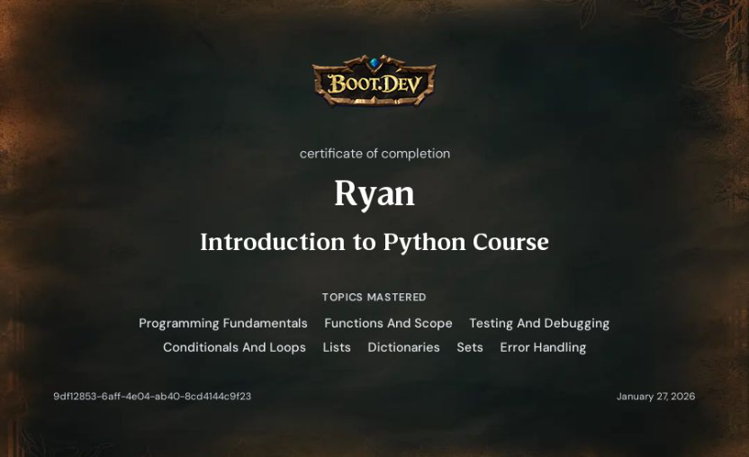
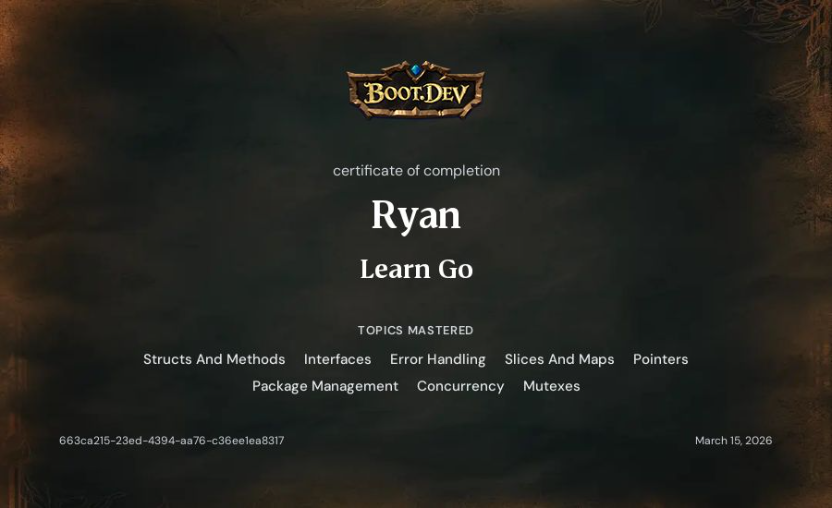
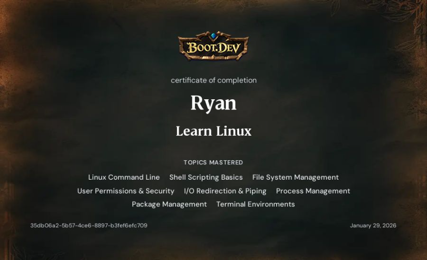
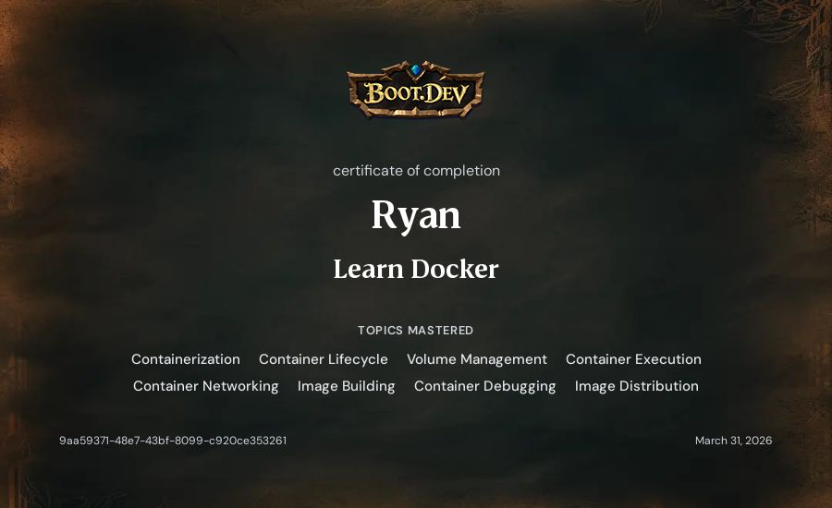
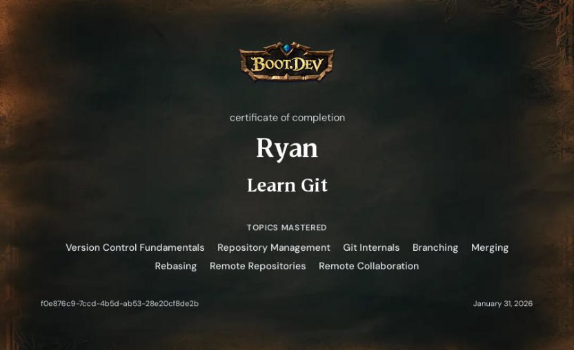
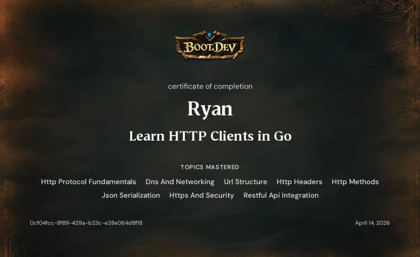
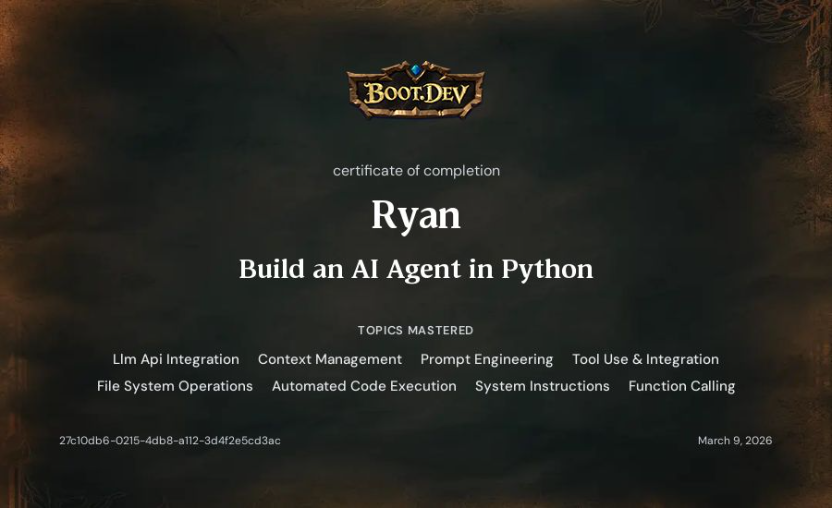
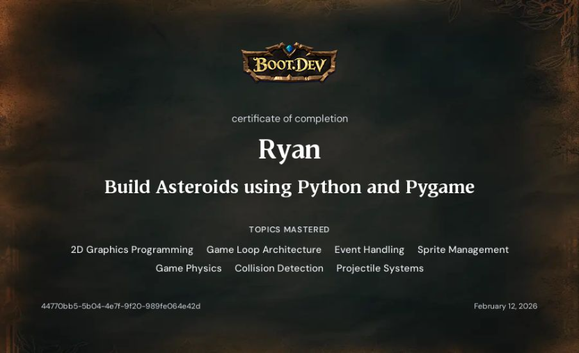
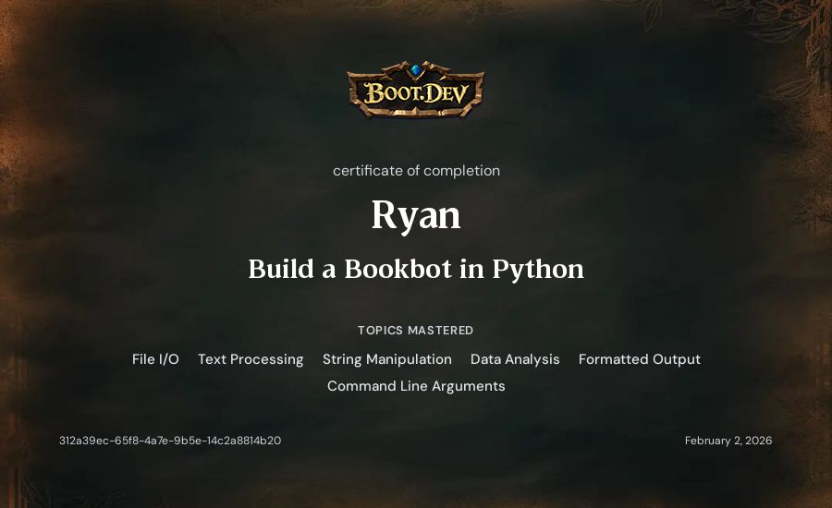
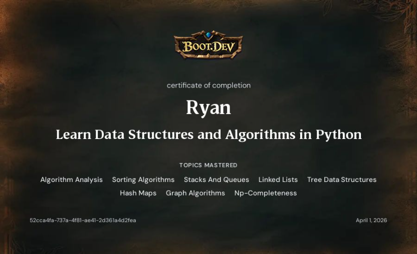
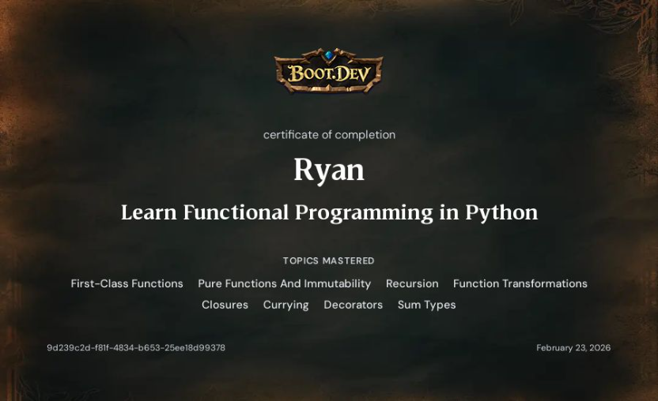
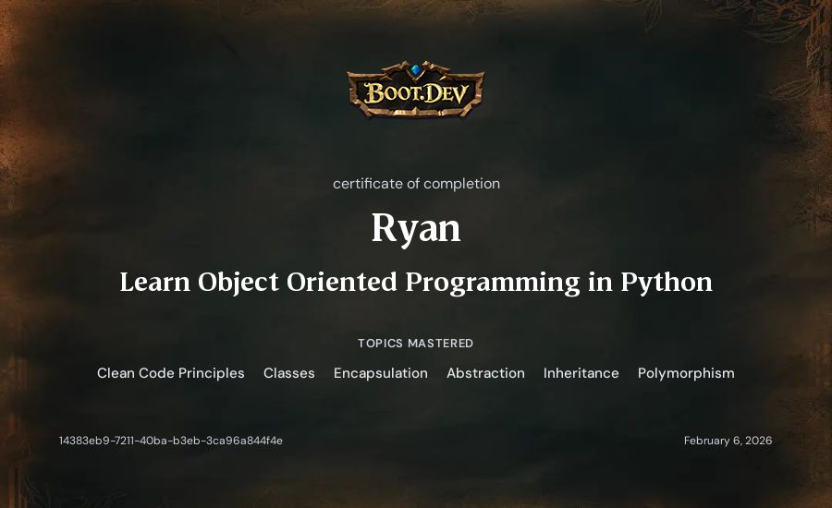
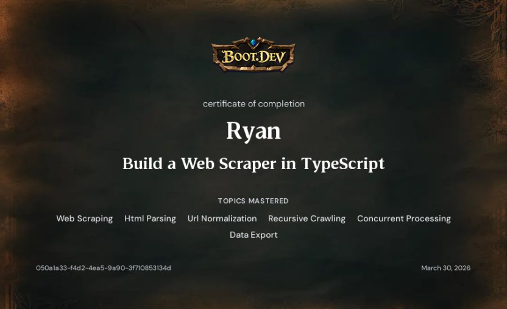

  

